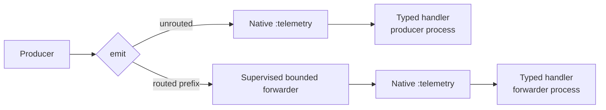

# Sinal

[](https://github.com/gleam-dream/sinal/actions/workflows/ci.yml)
[](https://hex.pm/packages/sinal)
[](https://gleam.run/)

Sinal gives Gleam applications typed events and observers on Erlang/BEAM. Measurements and metadata remain Gleam values in application code and become ordinary names and maps for native Erlang and Elixir `:telemetry` handlers.

Install Sinal from Hex:

```sh
gleam add sinal
```

Sinal requires Gleam 1.18 or newer and `telemetry` 1.4.2 through the 1.x series. It supports the Erlang target. Commit `gleam.toml` and `manifest.toml` to retain the resolved versions.

## When to use it

Use Sinal to report typed facts through BEAM's shared telemetry registry: service instrumentation, typed observers for metrics or logging adapters, spans around local work, and correlation values between application layers. Applications can route selected events through a supervised forwarder when callbacks would slow producers.

Sinal does not provide an exporter, metric aggregation, durable delivery, remote trace propagation, or business workflow and authorization control. Applications and adapters own those responsibilities.

## Capabilities

- Define events with typed measurements and metadata.
- Encode and decode primitive, custom, optional, enum, and record fields.
- Attach typed observers or fallible handlers to one or more events, with labels and stable handler IDs.
- Scope a group of subscriptions around work and inspect cleanup failures.
- Instrument work with native start, stop, and exception span events.
- Carry bounded correlation values in optional or required metadata fields.
- Route event-name prefixes to an optional supervised, bounded forwarder.

## Define, observe, and emit

Import `sinal` and `sinal/fields`, then define an event once and share it
between producers and observers:

<!-- prettier-ignore-start -->

<!-- snips: examples/usage/src/usage/observe.gleam#observe-request -->
```gleam
pub fn observe_request_example() {
  let finished =
    sinal.event(
      ["request", "finished"],
      fields.int("duration_ms"),
      fields.string("route"),
    )
  let attachment =
    sinal.observe(finished, fn(_duration_ms, _route) {
      // Runs in the emitting process, before `emit` returns.
      Nil
    })
  sinal.emit(finished, 42, "/users")
  let assert Ok(Nil) = sinal.detach(attachment)
}

```

<!-- prettier-ignore-end -->

`Event(measurements, metadata)` pairs the native event name with two `Fields` codecs. Record codecs use named field bindings and explicit getters. See the [record and enum example](examples/usage/src/usage/records.gleam) for the compiled round-trip check.

## How dispatch works

The event definition and codecs allocate no process. Sinal encodes values as native maps, then native telemetry selects and invokes the registered handlers. Unrouted callbacks run inline; prefix routing hands an occurrence to the chosen forwarder before the forwarder invokes handlers.



Applications supervise and configure forwarders at startup. This excerpt from the
[forwarding example](examples/usage/src/usage/forwarding.gleam) uses
`gleam/erlang/process`, `gleam/otp/static_supervisor`, and `sinal/forwarder` to route
a library's event prefix:

<!-- prettier-ignore-start -->

<!-- snips: examples/usage/src/usage/forwarding.gleam#forward-library -->
```gleam
pub fn isolate_library(name: process.Name(forwarder.Message)) -> Nil {
  let observations = forwarder.new(name)
  let assert Ok(_) =
    static_supervisor.new(static_supervisor.OneForOne)
    |> static_supervisor.add(forwarder.supervised(observations))
    |> static_supervisor.start
  // Every `sinal.emit` of an event named `my_library..` now returns as soon
  // as the event is handed to the forwarder.
  forwarder.route(["my_library"], observations)
}

```

<!-- prettier-ignore-end -->

## Operational limits

- Event-name segments, field keys, and route prefixes become permanent BEAM atoms. Keep them in source code; never build them from request or user input.
- Without a route, observers run synchronously in the emitting process and can delay it. A malformed native map skips one callback and reports a typed failure; a fallible handler that returns an error is removed by native telemetry.
- Forwarding is best effort. Its default capacity is 1,024 events, queued plus executing. A full or unavailable forwarder drops and counts an event; it does not retry, fall back to inline execution, or provide a delivery receipt. Pending events can be lost at shutdown.
- Forwarded handlers run in the forwarder process, without the producer's process-local context. Native spans stay in one process and ignore routes.

## Examples and reference

The [compiled usage examples](examples/usage/README.md) cover handlers, scopes, spans, correlation, and forwarding. See the API docs for [events and subscriptions](src/sinal.gleam), [field codecs](src/sinal/fields.gleam), [correlation](src/sinal/correlation.gleam), [spans](src/sinal/span.gleam), and [forwarding](src/sinal/forwarder.gleam). The [design](docs/design/design-layer.pdf) documents ownership and contracts; [benchmark notes](docs/BENCHMARKS.md) record a dated local run and its limits.
